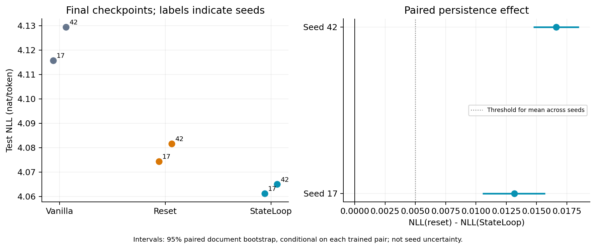
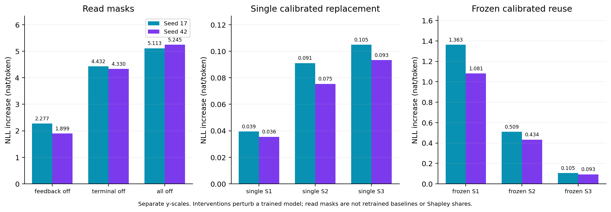
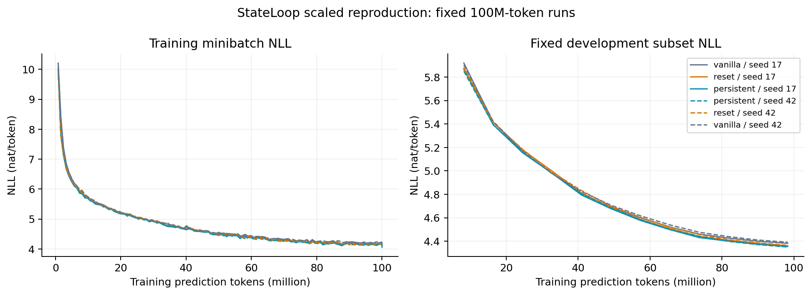
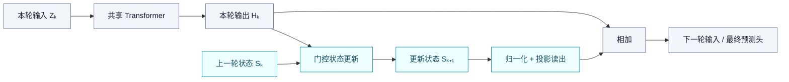

<div align="center">

# StateLoop · 本机复现

**Persistent State for Looped Transformers**<br>
在单张 V100 上，检验跨迭代持久状态的作用。

[](https://arxiv.org/abs/2610.35544)
[](experiments/stateloop-20261028-local48/review.md)
[](experiments/stateloop-20261028-local48/environment.json)
[](configs/protocol.json)

[实验结果](#results) · [核心机制](#mechanism) · [复现指南](#reproduce) · [证据索引](#evidence) · [完整报告](experiments/stateloop-20261028-local48/review.md)

</div>

---

本项目是论文 [*StateLoop: Persistent State for Looped Transformers*](https://arxiv.org/abs/2610.35544) 的独立、缩小规模实现。围绕一个问题展开：**在参数量、初始化、数据顺序和训练预算相同的条件下，保留跨 loop 状态，能否比每轮重置状态获得更低的测试损失？**

六组训练与全部评价已完成，数值审计和科学审查通过。两个种子均观察到持久状态的额外收益，达到预先冻结的探索性判定标准。

| 实验规模 | 正式训练 | 状态干预 | 实际耗时 |
|:---:|:---:|:---:|:---:|
| **约 53M** 参数 · 4 loops | **3 模型 × 2 种子** | **18 项** | **7.09 h** 至全部评价结束 |
| 单张 V100 32GB | 每组约 100M tokens | 读出屏蔽与状态复用 | 48 h 预算内完成审查与发布 |

> **结论范围：初步支持。** 本次检验的是缩小规模下的核心机制。两种子、短训练预算和数据子集不足以支持论文完整规模的性能结论；本仓库为独立实现。

<a id="results"></a>

## 实验结果

### 持久状态带来小幅、方向一致的改善

全部结果来自固定训练 token 预算的最终检查点，使用相同的 **1,000,000 个测试 prediction tokens、753 篇文档**。NLL 与 PPL 均越低越好；PPL 由 token 加权 NLL 取指数得到。

| 模型 | 参数量 | Seed 17 NLL ↓ | Seed 17 PPL ↓ | Seed 42 NLL ↓ | Seed 42 PPL ↓ |
|:---|---:|---:|---:|---:|---:|
| Vanilla Looped | 52.80M | 4.115756 | 61.2985 | 4.129443 | 62.1433 |
| Reset state | 53.39M | 4.074373 | 58.8136 | 4.081618 | 59.2412 |
| **Persistent StateLoop** | **53.39M** | **4.061201** | **58.0440** | **4.064998** | **58.2648** |

主指标定义为 **ΔNLL = NLL(reset) − NLL(persistent)**。Reset 与 persistent 完全匹配参数量和初始权重；vanilla 参数量较少，作为辅助对照。

| 种子 | ΔNLL ↑，nat/token | 配对文档 bootstrap 95% 区间 | 相对 reset 的 PPL 降幅 |
|:---:|---:|:---:|---:|
| 17 | +0.013172 | [0.010556, 0.015705] | 1.31% |
| 42 | +0.016620 | [0.014740, 0.018481] | 1.65% |

**平均 ΔNLL 为 +0.014896 nat/token**，对应 PPL 比值的几何平均改善 **1.48%**。冻结规则要求“两种子均为正，均值至少 0.005”，本次满足。上述区间条件于每对已经训练好的模型，**不包含训练种子不确定性**。



<p align="center">
  <a href="experiments/stateloop-20261028-local48/figures/primary-comparison.pdf">下载 PDF</a> ·
  <a href="experiments/stateloop-20261028-local48/assessment.json">完整测量 JSON</a>
</p>

### 持续更新状态比冻结早期状态更有效

每个 persistent 检查点接受 9 项干预：3 种读出屏蔽，以及在 S1、S2、S3 上分别进行单次校准替换和持续冻结复用。校准统计来自独立的 500,000-token 划分，所有干预继续执行 backbone。



两个种子都呈现相同模式：单次替换较晚状态的损害更大；在 S1/S2 开始持续冻结，比仅替换一次损害更大。S3 的两种干预完全相同，因为只剩一个后续边界。

这些结果与“持续状态更新有助于预测”一致。读出屏蔽衡量已训练模型对状态路径的依赖，**不能替代重新训练的基线**；这里的 group masks 也不等于论文的精确 Shapley 归因。完整解释见 [科学审查](experiments/stateloop-20261028-local48/review.md)。

<details>
<summary><strong>查看训练曲线与评价口径</strong></summary>



开发集曲线使用固定的 65,536-token 子集，最终 dev 指标使用完整 1M-token 划分。原 `validation.jsonl` 的 `tokens` 字段表示评价 token 数；图中的训练进度由 `step × 32 × 512` 恢复。学习曲线和基本学习门槛均不能证明训练已经收敛。

[学习曲线 PDF](experiments/stateloop-20261028-local48/figures/learning-curves.pdf) · [干预图 PDF](experiments/stateloop-20261028-local48/figures/state-interventions.pdf)

</details>

<a id="mechanism"></a>

## 核心机制

Looped Transformer 重复调用共享 backbone。StateLoop 在直接隐藏状态通路之外，为每个 token 增加一份跨 loop 更新的状态，并通过中间 feedback read 和最终 terminal read 参与计算。



**这里的“持久”指一次前向传播内部的 loop 轴。** 每个新样本前向计算都从零状态开始，状态不跨样本或 optimizer step 保留。

| 对照 | 状态更新 | 用途 |
|:---|:---|:---|
| Vanilla Looped | 无额外状态分支 | 共享 backbone 的辅助基线 |
| Reset state | `Sₖ₊₁ = ηₖ ⊙ Pₖ` | 保留状态分支，去掉旧状态贡献 |
| Persistent StateLoop | `Sₖ₊₁ = (1 − ηₖ) ⊙ Sₖ + ηₖ ⊙ Pₖ` | 检验跨 loop 持久状态的额外作用 |

实现采用 identity token-axis mixer、选择性指数门控和完整跨 loop 反向传播；feedback 与 terminal 使用不同投影。对应论文公式、初始化选择和实现偏差详见 [方法溯源](experiments/stateloop-20261028-local48/method-traceability.md) 与 [模型代码](stateloop/model.py)。

<a id="protocol"></a>

## 实验配置与资源

| 配置 | 本次取值 |
|:---|:---|
| Backbone | 8 层共享 Transformer；width 384；6 heads；FFN 1024 |
| 循环与状态 | 4 loops；state width 384；identity mixer |
| 序列与 batch | context 512；microbatch 8；有效 batch 32 |
| 每组预算 | **99,991,552 prediction tokens / 6,103 optimizer steps** |
| 训练策略 | AdamW；峰值 LR 3e-4；2% warmup；cosine 衰减至 10%；clip 1 |
| 数值精度 | FP16 autocast；状态递推、归一化统计和损失使用 FP32 |
| 数据 | 固定版本 deduplicated Pile 的两个 shard；按规范化文档哈希划分 |
| Tokenizer | 固定版本 `EleutherAI/pythia-70m` tokenizer |
| 环境 | Python 3.10.14；PyTorch 2.2.2+cu121；单张 V100-SXM2-32GB |

六组共处理 **599,949,312 prediction tokens**。正式训练循环累计 **5.31 h**；准备至全部评价结束 **7.09 h**。正式训练峰值 PyTorch allocated memory 为 **6.04 GiB**；结束时实验目录占用约 **6.27 GiB**，包含本地数据与检查点，不包含软链接指向的既有 Python 环境。

正式训练没有失败或科学重跑。准备阶段的网络故障和一次推送查询异常均保留记录并已解决。资源口径与事件详情见 [resources.json](experiments/stateloop-20261028-local48/resources.json)、[准备阶段记录](experiments/stateloop-20261028-local48/preflight-review.md) 和 [发布事件记录](experiments/stateloop-20261028-local48/publication-incidents.json)。

<a id="reproduce"></a>

## 复现指南

### 获取代码与检查实现

以下命令从项目根目录执行。依赖版本固定在 [requirements.txt](requirements.txt)；原实验使用支持 V100 的 PyTorch 2.2.2 CUDA 12.1 构建。

```bash
git clone https://github.com/Flutter-Misdreavus/stateloop-local-reproduction.git
cd stateloop-local-reproduction

python3.10 -m venv runtime/venv
source runtime/venv/bin/activate
python -m pip install -r requirements.txt
python -m pytest -q tests
```

原实验的 **10 项测试通过**，覆盖初始化配对、K=1 等价性、关闭读出后与 vanilla 等价、因果性、梯度传播、保存恢复、损失计算与统计逻辑。GPU 训练前还完成 FP16 检查、tiny overfit 和真实数据 smoke。

### 在原实验机器上复核

保留的 `runtime/` 包含数据、检查点和逐文档统计；原环境入口为 `runtime/venv/bin/python`。

```bash
runtime/venv/bin/python scripts/review_results.py
runtime/venv/bin/python scripts/plot_results.py
```

第一条命令重新检查数据与检查点哈希，并独立复算 NLL、PPL 和配对文档 bootstrap；第二条命令生成三套 PNG/PDF 图表。重新生成会更新审计或图表文件，需要相应更新审查记录。公开仓库只包含聚合指标，单独克隆后无法重算逐文档 bootstrap。

### 在新机器上开展一次独立复现

当前仓库保留的是一轮已经完成的冻结实验，部分脚本带有原始 run ID、输出路径和发布目标。原绝对截止时间为 **2026-10-30 11:38:32 UTC**，训练与评价代码会执行该限制。

启动新实验前，需要登记新的协议、截止时间与 run ID，同步调整输出路径，并配置自己的发布目标。`stateloop.supervise` 会提交和推送阶段产物；只需训练时，可使用 `stateloop.train` 单次运行接口，并在六组通过可靠性门槛后组织评价。冻结配置及代码应在执行前提交。

<details>
<summary><strong>展开原实验执行顺序与命令</strong></summary>

以下记录原始工作流，配合原 run ID 使用；新实验需先完成上述配置调整。数据准备之后，所有阶段均先检查证据，再进入下一步。

```bash
# 1. 数据准备、吞吐测量和 tiny overfit
python scripts/prepare.py
python -m stateloop.preflight benchmark --candidate preferred \
  --output experiments/stateloop-20261028-local48/benchmark-preferred.json
python -m stateloop.preflight overfit --candidate preferred \
  --output experiments/stateloop-20261028-local48/overfit-preferred.json

# 2. 生成 smoke 配置；提交配置后执行
python scripts/freeze.py --stage smoke
python -m stateloop.train --variant persistent --seed 123 \
  --run-id stateloop-20261028-smoke --config configs/smoke.json

# 3. 审查 smoke，通过后冻结正式配置；提交代码与配置后执行
python scripts/freeze.py --stage formal
python -m stateloop.supervise

# 4. 六组训练通过后，supervisor 自动执行测试与干预
#    随后独立审计、绘图，并撰写科学审查
python scripts/review_results.py
python scripts/plot_results.py
```

训练器拒绝默默覆盖已有运行报告。原始完整矩阵顺序为 vanilla/17 → reset/17 → persistent/17 → persistent/42 → reset/42 → vanilla/42。测试集未用于选择超参数、训练预算或检查点。

</details>

<a id="evidence"></a>

## 证据与代码导航

| 阅读目标 | 入口 |
|:---|:---|
| 理解结果、解释与局限 | [完整中文审查报告](experiments/stateloop-20261028-local48/review.md) |
| 核对假设、判定规则与固定配置 | [实验协议](configs/protocol.json) · [冻结配置](configs/frozen.json) |
| 对照论文公式与实现 | [方法溯源](experiments/stateloop-20261028-local48/method-traceability.md) · [model.py](stateloop/model.py) |
| 核对数据来源和输入检查 | [数据清单](experiments/stateloop-20261028-local48/data-manifest.json) · [输入审计](experiments/stateloop-20261028-local48/input-audit.json) |
| 查看所有测试与干预数值 | [assessment.json](experiments/stateloop-20261028-local48/assessment.json) |
| 核对实际运行版本与统计复算 | [completion-audit.json](experiments/stateloop-20261028-local48/completion-audit.json) |
| 核对最终审查状态与产物哈希 | [matrix.json](experiments/stateloop-20261028-local48/matrix.json) · [review.json](experiments/stateloop-20261028-local48/review.json) |

<details>
<summary><strong>项目目录</strong></summary>

```text
stateloop-local-reproduction/
├── stateloop/
│   ├── model.py            # 三种模型与状态干预
│   ├── train.py            # 固定 token 预算训练与恢复
│   ├── assess.py           # 测试、状态干预与文档 bootstrap
│   ├── preflight.py        # 吞吐、数值与 tiny-fit 检查
│   ├── runtime.py          # 数据读取、评价与版本工具
│   ├── supervise.py        # 六组矩阵与阶段发布
│   └── launch.py           # 准备、smoke 与正式矩阵编排
├── scripts/                # 数据准备、冻结、独立审计与绘图
├── configs/                # 数据版本、实验协议与冻结配置
├── tests/                  # 机制与管线验证
├── experiments/
│   ├── stateloop-20261028-local48/  # 总报告、审计、图表
│   └── stateloop-20261028-*/        # 各组配置、指标与运行版本
└── runtime/                # 仅本机：数据、权重、环境入口与日志
```

</details>

每组报告记录**实际执行 commit**，后续审查和文档提交不替代训练版本。六组运行的核心模型、训练和 runtime 代码内容一致；完整 SHA256 与每组版本列于审计文件。结果审查发布版本为 [`9de886e`](https://github.com/Flutter-Misdreavus/stateloop-local-reproduction/commit/9de886ec6fb3e6bef3b267ef0205f19b0060e8e0)，后续 README 更新属于文档改进。

`assessment.json` 保留自动评价结束时的 `gpt_review: PENDING`，以维持原始测量哈希；最终审查以 `review.md`、`review.json` 和 `matrix.json` 为准。公开内容包括代码、配置、聚合指标、来源哈希和图表；原始数据、模型权重、环境及原始执行日志保留本机。

<a id="limits"></a>

## 结论边界

- **规模差异。** 论文 Table 4 采用约 410M 参数、7 loops、25B tokens；本次约 53M、4 loops、100M tokens，绝对 PPL 不可直接比较。
- **训练与随机性。** 仅两个训练种子、约 1.87 tokens/parameter，不能证明收敛或跨随机性的强显著性。
- **数据范围。** 两个 shard、512-token context；精确文档及对齐 token 块去重不能排除所有近重复。
- **机制解释。** 收益可能涉及状态存储、梯度传播或优化变化。读出屏蔽与状态复用不能唯一识别原因，通道校准也不能消除所有分布偏移。
- **覆盖范围。** 本次完成持久性主对照和部分状态干预；未覆盖完整规模、其他 mixer、GRU/state-only 消融、深度扫描或精确 Shapley。

论文方法与结果归原作者所有。本仓库提供独立实现及其可审查证据；引用或讨论结果时，请注明 **scaled mechanism reproduction**，并同时参考[原论文](https://arxiv.org/abs/2610.35544)与[本次报告](experiments/stateloop-20261028-local48/review.md)。
